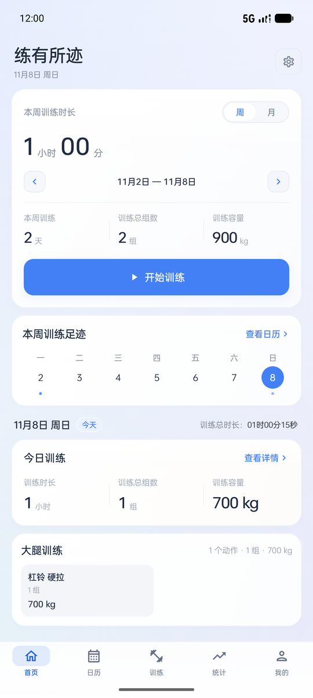
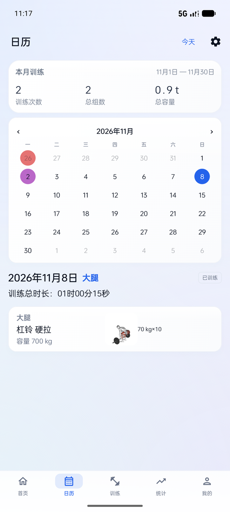
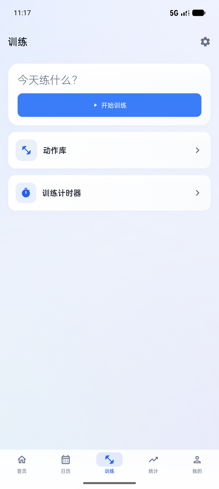
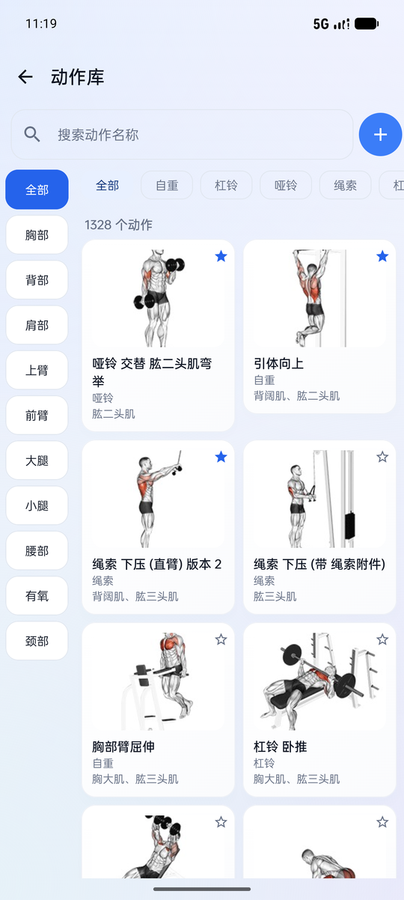
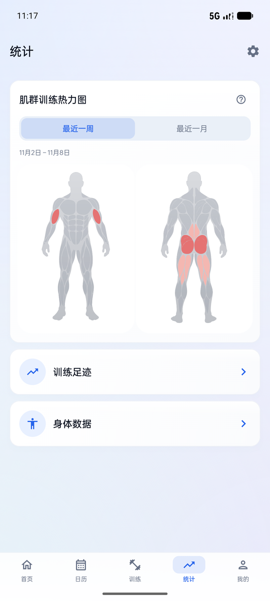

# 练有所迹 · GymLog

> 一个装在手机里的力量训练记录本。不注册、不联网、不上传，训练数据只存在你自己的手机上。

- 当前版本：**1.6.3**（2026-11-10），支持 Android 7.0（API 24）及以上
- 界面语言：简体中文；系统语言为英文时，启动器显示为 **Traivol**
- 应用包名：`com.example.gymlog`
- 单 Activity + Jetpack Compose + Room，无账号体系、无网络同步

<p align="center">
  
</p>

<p align="center">
  
  
  
  
</p>

<p align="center">
  <sub>界面截图来自 1.6.2 Debug 包，运行于 Android 模拟器（API 37，1344 × 2992）。</sub>
</p>

## 主要功能

| 页面 | 能做什么 |
| --- | --- |
| 首页 | 按周 / 按月看训练时长、天数、组数、容量；一行七天的训练足迹；当天的训练汇总 |
| 日历 | 月历按当天训练部位上色，标记休息 / 放纵 / 偷懒日；查看和编辑选中日期的训练记录 |
| 训练 | 逐组记录训练（普通重量 / 自重 / 自重负重三种模式）、自动计时、动作完成后收起、草稿在进程被杀后可恢复；动作库、训练计时器 |
| 统计 | 训练容量与成绩（PR）曲线、身体数据曲线、肌群训练热力图 |
| 我的 | 个人资料与头像、身体围度与人体肌群图、照片墙、数据管理 |

其他能力：

- **动作库**：内置 1283 个动作，带中文名称、常见别名、分类、演示缩略图与 GIF，可搜索、筛选、收藏、自定义动作与关联肌群；动作详情有「动作怎么做」步骤与发力 / 姿态 / 节奏 / 常见错误四段要点。
- **训练中通知**：训练开始后通知栏常驻一条静音通知，点按回到同一份草稿，后台也能看到总时长与组歇 / 秒表状态。
- **照片墙**：从相册或相机添加照片，支持裁剪、旋转、涂鸦、文字、马赛克和模糊，按日期浏览。
- **数据备份**：手动导出 / 导入 JSON；冷启动时会检查并自动生成一份本地备份（距上次超过 6 小时才生成，保留最近 3 份，可从某一份恢复）。
- **外观**：浅色 / 深色 / 跟随系统、日历配色（鲜明 / 柔和 / 自定义）、OPPO Sans 3.0 字体。

## 获取与安装

- 历史安装包见 [GitHub Releases](https://github.com/Akineru/GymLog/releases)，1.6.3 的包已附在 `v1.6.3` 下。
- 没附安装包的版本可以按下面步骤自行构建。
- 自行构建得到的是 **Android Debug 证书签名的包**，可覆盖安装同签名的旧包，不是应用商店的正式签名包；仓库内不提供正式签名配置。

## 自己构建

### 环境

| 项目 | 版本 / 要求 |
| --- | --- |
| Android SDK | compileSdk / targetSdk 37，minSdk 24 |
| JDK | 25（Android Studio 自带 JBR 即可）；Gradle toolchain 配置为 25，首次同步可能需要下载对应 JDK |
| Kotlin | 2.2.10 |
| Android Gradle Plugin | 9.4.1 |
| Compose BOM | 2026.02.01 |
| Room | 2.8.5（KSP 2.2.10-2.0.2） |

### 构建前请先改一处配置

仓库里的 `gradle.properties` 含有开发机专用的 JDK 路径（`org.gradle.java.home` 与 `org.gradle.java.installations.paths`）。**克隆后请把这两行注释掉，或改成自己机器上的 JDK 路径**，否则 Gradle 会因为找不到该路径而直接失败。

另外 `gradle-daemon-jvm.properties` 会尝试下载 Temurin 25，首次构建需要能访问相应的 JDK 分发源。

### 步骤

```bash
git clone https://github.com/Akineru/GymLog.git
cd GymLog

# 用 Android Studio 打开工程；或命令行（Windows 用 gradlew.bat）
./gradlew :app:assembleDebug
./gradlew :app:testDebugUnitTest
./gradlew :app:assembleRelease --no-daemon --max-workers=1
```

产物在 `app/build/outputs/apk/` 下。

> Release 构建已关闭 R8 优化（`buildTypes.release.optimization.enable = false`）。此前开启会导致启动即崩溃，请勿随意打开。

## 数据与隐私

**数据全部留在设备本地**：训练与身体记录在 Room 数据库 `gymlog.db`，照片和头像在应用私有目录，外观、计时等偏好在 SharedPreferences。应用未声明 `INTERNET` 权限，也没有账号、云同步或统计上报；同时设置了 `android:allowBackup="false"`，不参与系统自动备份，数据由用户通过应用内导出自行保管。

| 权限 | 用途 |
| --- | --- |
| `POST_NOTIFICATIONS` | Android 13+ 显示训练中常驻通知、倒计时到点提醒（运行时申请，拒绝后不影响记录训练） |
| `USE_EXACT_ALARM` | 倒计时到点准时提醒 |
| `FOREGROUND_SERVICE` / `FOREGROUND_SERVICE_SPECIAL_USE` | 训练中常驻通知的前台服务 |
| `VIBRATE` | 倒计时到点震动 |

不申请相机权限、定位权限，也不读取传感器。照片墙通过系统选择器或相机 Intent 取图，临时文件经 FileProvider 在应用内交换。

关于备份，有两点需要注意：

- 备份是**整库替换**，不是合并；旧版本备份文件仍然可以导入（格式只新增可选字段）。
- **照片墙不进备份 JSON**，删除应用或卸载会一并丢失私有目录里的照片；导入备份、清除本地数据都不会删除已有照片，清除数据前会二次确认。换机前请自行导出照片。

## 项目结构

```text
app/src/main/java/com/example/gymlog/
  MainActivity.kt / GymLogApplication.kt   入口与初始化
  data/                                    Entity、Dao、数据库迁移、纯逻辑（重量 / PR / 日历 / 计时等）
  ui/GymLogApp.kt                          页面导航与五个根页面
  ui/home, calendar, train, session, ...   按功能划分的界面
  ui/theme/                                主题、品牌色、全站卡片材质
app/src/main/assets/exercises/             动作数据集、缩略图与 GIF 各 1283 份、素材说明
app/src/main/assets/muscle_masks/          男 / 女、正 / 背肌肉遮罩
app/src/main/res/                          图标、底图与中文文案
app/src/test/                              逻辑与数据库迁移单元测试
airead.md                                  详细开发与接手说明（中文）
```

依赖方向：界面 → Repository → Dao；容量、成绩、日历上色、首页汇总等算法集中在 `data/`，便于单测。

## 验证状态

如实记录，便于判断可用性：

- **单测**：`:app:testDebugUnitTest`，基于 JUnit + Robolectric + 内存 Room，覆盖数据库迁移与主要纯逻辑；界面导航不在单测范围内。
- **已验证**：1.6.3 的 Debug 包在 API 37 模拟器与一台 Android 16 真机上冷启动无崩溃，并验收过主要界面。
- **未做系统回归**：Android 7–12 真机、平板 / 折叠屏、其他语言环境、各类国产 ROM 的后台行为。
- **已知系统限制**：部分国产 ROM（如一加 ColorOS）会推迟应用的精确闹钟与后台任务，倒计时到点提醒可能不准；应用只能提示检查系统耗电设置，无法从代码侧绕过。

## 已知限制

- 暂不提供：复制组、组间休息计时、估算 1RM、热身组、训练计划（占位页）。
- 月视图下三项统计的标签仍显示「本周训练」，未随周 / 月切换联动。
- 部分弱化标签与品牌蓝文字的对比度未达 WCAG AA，是当前配色的取舍。
- 界面文案以简体中文为主；英文资源目前只覆盖应用名、通知、训练偏好等部分文案，尚未提供完整英文本地化。

## 参与开发

改动前请先看仓库内的 [`airead.md`](airead.md)（中文，含完整数据模型、历史需求与易踩的坑）。几条硬约束：

- 数据库升级只走 Room Migration，禁止破坏性迁移，禁止为了改表清掉用户数据。
- 备份格式只能新增可选字段，旧备份必须仍可导入；照片墙永远不进备份。
- 不引入 Navigation Compose，页面切换由 `GymLogApp.kt` 的内存状态管理。
- 「正在训练」通知只是计时的只读消费方，不得另起一套计时。
- 动作缩略图 / GIF 与人体肌肉素材是已有素材，不要重新生成，也不要改肌肉编号去凑文件名。
- 发版时把新版本说明插到 `app/src/main/java/com/example/gymlog/ui/settings/ReleaseNotes.kt` 列表最上面，并同步更新 `ReleaseHistoryTest` 的首条断言。

## 素材与授权

| 内容 | 来源与授权 |
| --- | --- |
| 动作数据与导入工具 | `exercises-dataset-zh`（源自 hasaneyldrm/exercises-dataset、ExerciseDB v1 by AscendAPI via Kaggle），MIT |
| 动作缩略图与 GIF | © Gym visual — https://gymvisual.com/ ，按 180×180 授权随 APK 打包，须保留署名并遵守其使用条款 |
| 备用示意图 | Bryl Lim / Everkinetic，CC BY-SA 4.0 |
| 字体 | OPPO Sans 3.0（官方免费商用） |
| 人体底图与肌肉遮罩 | 项目内独立素材，见 `res/drawable-nodpi` 与 `assets/muscle_masks` |

应用内署名字符串 `exercise_art_credit`、[`assets/exercises/NOTICE.txt`](app/src/main/assets/exercises/NOTICE.txt) 和授权确认记录 [`tools/exercise_audit/PHASE_F_AUTHORIZATION.md`](tools/exercise_audit/PHASE_F_AUTHORIZATION.md) 请保留，不要删除。素材授权仅适用于本项目随包发布，不代表可单独再分发这些素材。

## 许可

本仓库**尚未添加 `LICENSE` 文件**，代码许可待定；在补充许可证之前，请勿假定代码可按某个开源许可使用。第三方素材按上表各自的授权处理，与代码许可相互独立。
